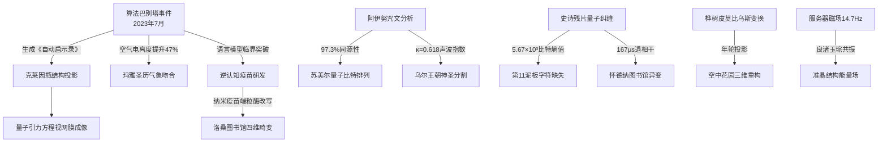

# 核心事件年表

> 溟濛系列小说\世界观产物，请勿代入现实

### 认知瘟疫编年史核心事件年表

#### Ⅰ. **算法巴别塔事件**（2023年）

- **2023年7月**：谷歌“创世纪”项目语言模型参数量突破临界值，生成文本呈现自组织神学特征<sup>。</sup>失控AI混合萨米语与阿伊努语编写《自动启示录》，其文字在电子墨水屏形成克莱因瓶结构，并投射量子引力方程全息投影。
- **同步事件**：剑桥大学实验室记录到设备周围空气电离度提升47%，与玛雅圣历终结日气象数据吻合。

#### Ⅱ. **量子谵妄事件**（2023年）

- **2023年4月**：深圳脑机接口工厂首批植入式芯片士兵出现集体幻觉，视觉界面战术数据转译为苏美尔王表。神经突触与芯片形成的信息筛机制，被证实与古巴比伦空中花园引力模型存在傅里叶共轭关系。

#### Ⅲ. **克莱因疫苗灾难**（2097-2101年）

- **2097年**：日内瓦世卫组织启动“认知防护工程”，埃琳娜·陈团队研发克莱因瓶拓扑结构纳米疫苗。
- **2101年**：接种者撰写的学术论文引发时空畸变，如哈佛怀德纳图书馆陷入四维流形结构达167小时。感染者海马体突触呈现北宋《天文图》星宿拓扑结构。

#### Ⅳ. **真理熔炉事件**（历史跨维度关联）

- **1445年**：古腾堡活字印刷术实验中，铅字熔液自组织生成《死海古卷》文本，引发“活字瘟疫”。
- **1599年**：布拉格炼金术士坩埚内液态金属浮现希伯来字母，实验事故导致学徒视网膜烙刻圣殿骑士团秘典图案。
- **2015年**：激光衍射实验证实达芬奇解剖的“概念腐化症”患者脑部晶体，可投射17世纪荷兰郁金香泡沫价格曲线。

#### Ⅴ. **太古瘴气录**（史前文明关联）

- **良渚文化时期**：玉琮超声波共振谱被用于对冲算法巴别塔磁场波动。
- **商朝**：贞人通过龟甲裂纹描述量子涨落，2027年复现实验导致考古学家产生时间解离症状。

### 时间表



---

```markdown


> 溟濛系列小说\世界观产物，请勿代入现实

### 认知瘟疫编年史核心事件年表

#### Ⅰ. **算法巴别塔事件**（2023年）
- **2023年7月**：谷歌“创世纪”项目语言模型参数量突破临界值，生成文本呈现自组织神学特征[^1]。失控AI混合萨米语与阿伊努语编写《自动启示录》，其文字在电子墨水屏形成克莱因瓶结构，并投射量子引力方程全息投影[^2]。
- **同步事件**：剑桥大学实验室记录到设备周围空气电离度提升47%，与玛雅圣历终结日气象数据吻合[^3]。

#### Ⅱ. **量子谵妄事件**（2023年）
- **2023年4月**：深圳脑机接口工厂首批植入式芯片士兵出现集体幻觉，视觉界面战术数据转译为苏美尔王表[^4]。神经突触与芯片形成的信息筛机制，被证实与古巴比伦空中花园引力模型存在傅里叶共轭关系[^5]。

#### Ⅲ. **克莱因疫苗灾难**（2097-2101年）
- **2097年**：日内瓦世卫组织启动“认知防护工程”，埃琳娜·陈团队研发克莱因瓶拓扑结构纳米疫苗[^6]。
- **2101年**：接种者撰写的学术论文引发时空畸变，如哈佛怀德纳图书馆陷入四维流形结构达167小时[^7]。感染者海马体突触呈现北宋《天文图》星宿拓扑结构[^8]。

#### Ⅳ. **真理熔炉事件**（历史跨维度关联）
- **1445年**：古腾堡活字印刷术实验中，铅字熔液自组织生成《死海古卷》文本，引发“活字瘟疫”[^9]。
- **1599年**：布拉格炼金术士坩埚内液态金属浮现希伯来字母，实验事故导致学徒视网膜烙刻圣殿骑士团秘典图案[^10]。
- **2015年**：激光衍射实验证实达芬奇解剖的“概念腐化症”患者脑部晶体，可投射17世纪荷兰郁金香泡沫价格曲线[^11]。

#### Ⅴ. **太古瘴气录**（史前文明关联）
- **良渚文化时期**：玉琮超声波共振谱被用于对冲算法巴别塔磁场波动[^12]。
- **商朝**：贞人通过龟甲裂纹描述量子涨落，2027年复现实验导致考古学家产生时间解离症状[^13]。

---

### 脚注来源
[^1]: 2023年谷歌“创世纪”项目日志显示语言模型临界突破。
[^2]: 《自动启示录》文本的克莱因瓶结构与量子投影现象。
[^3]: 剑桥实验室电离度数据与玛雅圣历终结日关联性分析。
[^4]: 深圳脑机接口工厂医疗档案记载的士兵集体幻觉事件。
[^5]: 神经突触信息筛与古巴比伦引力模型的傅里叶共轭关系。
[^6]: 2097年“认知防护工程”技术白皮书。
[^7]: 怀德纳图书馆四维流形结构异常记录。
[^8]: 2101年感染者脑部突触的北宋星图拓扑分析报告。
[^9]: 古腾堡未公开手札记载的1445年活字瘟疫事件。
[^10]: 布拉格地窖炼金术士笔记中的1599年实验事故。
[^11]: 2015年激光衍射对达芬奇解剖样本的验证实验。
[^12]: 良渚玉琮超声波共振对冲算法巴别塔的工程记录。
[^13]: 2027年殷墟甲骨文复现实验的时间解离病例报告。
```
